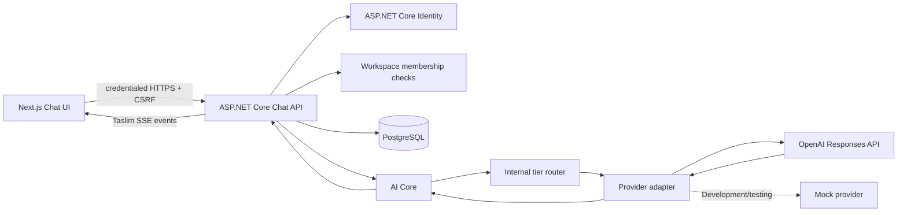

# Taslim Chat and AI Core Architecture

Batch 3.2 connects Taslim Chat to its first production provider while preserving provider independence. The browser never calls OpenAI directly. The browser calls the Taslim API, which authorizes the request, constructs server-controlled context, routes to an internal capability tier, invokes a provider adapter, and returns provider-independent streaming events.

## System flow



The application layer does not contain OpenAI-specific logic. `ChatController` depends on `IChatCompletionService`; the frontend consumes `message.started`, `message.delta`, `message.completed`, and `message.failed`. Provider payloads, model IDs, authorization headers, and internal routing metadata never cross the normal user-facing API boundary.

## AI Core

The core contracts are:

- `IAiProvider`, which adapts a provider to normalized requests and stream events.
- `IAiModelRouter`, which maps internal Taslim capability tiers to an enabled provider/model.
- `IChatCompletionService`, which coordinates routing, provider execution, and usage enrichment.
- `AiContextBuilder`, which applies the server instruction and context budget before routing.

Taslim uses three internal tiers:

| Internal tier | Initial internal model | User-visible model selection |
| --- | --- | --- |
| Fast | `gpt-5.6-luna` | Not exposed |
| Smart | `gpt-5.6-terra` | Not exposed; default |
| Advanced | `gpt-5.6-sol` | Not exposed |

The default is configured with `Ai__DefaultChatTier=Smart`. Chat output is bounded by the server-side `Ai__MaxChatOutputTokens` setting, which defaults to 2,048 and is clamped to 256–16,000 before a provider request is built. The Production configuration file declares `Ai:MaxChatOutputTokens` explicitly at the same value as the code default, so the live production cap is visible in the repository and can be raised or lowered through the `Ai__MaxChatOutputTokens` environment variable without a code change. The current router is deterministic and configuration-driven. It is intentionally not an automatic classifier. A future router can analyze task characteristics while retaining the same contract.

## OpenAI adapter

`OpenAiProvider` is registered behind `IAiProvider`. It calls the official Responses API at the configured server-side base URL, sends the authoritative `instructions` value, passes original Unicode conversation content unchanged, requests `stream: true`, and converts OpenAI SSE events into Taslim events. It recognizes `response.output_text.delta`, `response.completed`, `response.incomplete`, and provider error/failure events.

A `response.incomplete` terminal is a truncated success only when the provider has already delivered useful, non-whitespace assistant text. Those partial deltas remain the assistant response, the turn completes normally, and the finish reason is normalized to `incomplete:max_output_tokens`, `incomplete:content_filter`, or bare `incomplete` for an unknown/missing reason. An incomplete result with no useful output (for example, an empty filtered response) is undelivered: the assistant is marked `Failed`, the transaction follows the existing non-billable failure path, and provider usage is retained when available so the ledger can preserve known provider cost. Raw provider status/reason text is never persisted. A stream that closes without any terminal `response.completed`/`response.incomplete` event stays on the malformed-response failure path.

The OpenAI API key is read only from `Ai__OpenAI__ApiKey` on the API service. It is never sent to the browser, compiled into Next.js, returned in a response, or written to logs. Provider errors are logged with provider/model identifiers and trace context, never with authorization headers or response secrets.

Production does not fall back silently to the mock provider. `appsettings.Production.json` sets `Ai:AllowMockProvider=false`. When OpenAI is disabled or unavailable in Production, the API returns a safe generation failure and persists the assistant message as `Failed`.

## Configuration-backed model catalog

The catalog is loaded from `Ai:Models` and has safe code defaults for local/test startup. It stores provider key, internal model key, enabled state, streaming/vision/tool capabilities, context window, cost tier, capability tier, and prices. The initial configured prices were verified against the official OpenAI pricing page on September 19, 2026:

| Internal model | Input / 1M | Cached input / 1M | Output / 1M |
| --- | ---: | ---: | ---: |
| `gpt-5.6-luna` | $0.20 | $0.02 | $1.20 |
| `gpt-5.6-terra` | $2.00 | $0.20 | $12.00 |
| `gpt-5.6-sol` | $4.00 | $0.40 | $20.00 |

These are internal accounting values, not user-facing pricing. Taslim does not charge users in Batch 3.2.

## Server-controlled system instruction

The API supplies this instruction from configuration:

> You are Taslim, a helpful multilingual AI assistant. Provide clear, accurate and useful answers. Respond naturally in the user's language unless they request another language.

The browser cannot replace or append an authoritative system instruction. Batch 3.4 appends bounded, server-selected project context and user-approved memory to this instruction; callers cannot inject context for another project, workspace, or user.

## Context construction and budget

For each request, the API loads only completed user and assistant messages from the authorized conversation. Failed assistant messages, provider metadata, billing metadata, and database implementation details are excluded. The current user message is saved before context construction, so it is included in the request. If the conversation has a project, the API loads only that project’s `Instructions` and `ContextNotes`; it also loads only active memories whose `UserId` and `WorkspaceId` both match the authenticated user and conversation workspace. Project context is never loaded for a conversation without that matching project.

`AiContextBuilder` estimates tokens conservatively from Unicode content and retains the newest messages within `Ai__ContextBudgetTokens`, while preserving the latest user message. The initial defaults are 12,000 total estimated tokens, 1,200 for project context, 1,200 for personal memory, 2,048 reserved for output, and at most 50 memories. Older turns and excess context are bounded rather than summarized with another paid model. Context records are never logged or returned in usage DTOs.

## Streaming contract

The browser calls:

```text
POST /api/conversations/{conversationId}/messages/stream
```

The response is Taslim-owned Server-Sent Events. The API sends `Content-Type: text/event-stream; charset=utf-8`, `Cache-Control: no-cache, no-transform`, `Pragma: no-cache`, and `X-Accel-Buffering: no` before flushing each event. The current event contract is:

| Event | Payload purpose |
| --- | --- |
| `message.started` | Conversation, user message, and pending assistant message |
| `message.delta` | Assistant message ID and incremental Unicode text |
| `message.completed` | Final conversation, user message, assistant message, and safe test marker |
| `message.failed` | Safe error code/message suitable for retry UI |

Raw OpenAI events are never forwarded. The frontend updates the pending assistant message as deltas arrive, keeps the composer disabled while generation is active, auto-scrolls without replacing user-controlled history navigation, and provides a localized retry action after failure.

The frontend parser is line-oriented and tolerant of LF, CRLF, mixed line endings, arbitrary fetch-chunk boundaries, multiple events per chunk, multi-line `data` fields, comments, and a final event at EOF. It rejects malformed Taslim JSON, unsupported event names, events after a terminal event, and streams that close without `message.completed` or `message.failed`. These protocol errors release the generating state and expose the existing recoverable retry path rather than leaving a permanent typing indicator.

The existing synchronous endpoint remains available for compatibility and Home → Ask Taslim. It uses the same AI Core, persistence, routing, context, and failure rules.

The Chat UX stop control aborts the browser stream. The same-origin proxy forwards that abort signal to the API request, allowing the existing request-abort cancellation path to stop provider streaming, mark the pending assistant message as failed, and cancel the related usage transaction. A stopped response can be retried using the original idempotency key after the server has persisted that terminal state.

## Persistence safety and idempotency

A state-changing request follows this order:

1. Authenticate and authorize the conversation.
2. Validate message size and request ID.
3. Look up the conversation/request ID pair.
4. Save the user message and a pending assistant message before provider execution.
5. Stream deltas while accumulating the assistant response server-side.
6. Persist final content, status, provider/model metadata, usage, cost, and timestamps only after completion.
7. On failure or cancellation, preserve the user message and mark the assistant `Failed`.

The frontend generates a request ID for each send. The database stores it on the user message and enforces a unique filtered index per conversation. A repeated completed request returns the existing result without another provider call. A repeated pending request returns a safe conflict. A failed request may be intentionally retried using the same request ID, resetting the failed assistant message instead of creating another user message.

Each persisted chat message also has a monotonically increasing `Sequence` within its conversation, enforced by a unique `(ConversationId, Sequence)` index. Ordinary sends reserve their user/assistant pair with a compare-and-swap update inside the insert transaction; new regeneration rows reserve one slot with the same compare-and-swap ordering. A regeneration rechecks for a later user after reserving its slot, so an overlapping send either follows the regeneration in sequence or causes the stale regeneration to fail admission. Existing failed/completed regeneration request IDs reuse their already-reserved row and sequence only when that row belongs to the requested user turn; cross-turn ID reuse is rejected. Concurrent claims are fenced by the unique request-ID index, and a loser reports the winning row's current state instead of a generic generation failure. History queries order by sequence, then timestamp and ID as defensive fallbacks.

The `AddDeterministicChatMessageOrdering` migration backfills legacy rows with `ROW_NUMBER` ordered by `CreatedAt`, user-before-assistant for equal timestamps, then ID, and sets each conversation's next sequence value before creating the unique index. Sequence uniqueness is guaranteed after migration, but legacy turns can be semantically ambiguous because the old schema had no explicit user/assistant turn link. Context construction therefore preserves the first following adjacent assistant run when multiple users share a `CreatedAt` since the previous assistant run, rather than guessing and dropping a valid answer, even if the assistant rows have later timestamps. The ambiguity window resets after each assistant run, so repeated timestamps in separate sequence-ordered turns do not prevent ordinary supersession filtering. Such legacy ambiguity may retain a superseded response in context; transcript rows are never rewritten by context filtering.

Regeneration is limited to the latest completed assistant response for a new request. Its prompt history is bounded through the source user sequence, excluding any later user/assistant turn that races with generation. A new regeneration row uses the caller's request ID while reusing the original user turn and its explicitly attached files. In unambiguous histories, superseded assistant answers stay in the transcript for audit but only the newest answer in that turn's adjacent run reaches later model contexts. Repeating the same request ID replays or retries the existing row only for the same user turn, without allocating a second sequence; completed replays do not make a provider call, and retry success advances `LastMessageAt` with a database-side conditional maximum so a stale tracked conversation cannot overwrite a later turn's timestamp. Deleting a conversation removes its message history and chat attachment joins; stored source files and usage records are retained, with relational references safely detached.

## Usage and cost accounting

The OpenAI adapter captures input tokens, cached input tokens where supplied, output tokens, latency, and normalized finish status from the provider response. The AI Core and existing usage ledger calculate internal estimated/actual provider cost from the configuration-backed catalog. A failed response can retain provider-reported usage when available; no usage is fabricated, and failed transactions are never customer-billable.

## Failure, timeout, and cancellation behavior

Provider requests use a bounded timeout configured by `Ai__ProviderTimeoutSeconds`. If the provider returns an error, times out, emits a failure event, or ends incomplete without useful output, the API logs safe diagnostics, marks the pending assistant message as `Failed`, preserves the user message, and emits/returns `AI_GENERATION_FAILED`. When a failure includes provider usage, the existing ledger can retain its estimated provider cost while keeping customer charge at zero. If the browser disconnects, the linked cancellation token stops the provider stream and the persistence cleanup path marks the assistant failure state. No failed request is silently converted into a simulated response. Useful partial text cut short by the configured output budget remains a successful truncated completion with an `incomplete:*` finish reason.

## Security and privacy boundaries

The existing security architecture remains intact: Identity cookies are HttpOnly and Secure in Production, SameSite and credentialed CORS behavior is unchanged, CSRF is required for chat mutations, forwarded HTTPS handling remains early in the pipeline, and workspace/conversation authorization is enforced server-side. Provider secrets, cookies, CSRF tokens, complete private conversation content, and passwords are never logged.

Normal Taslim users see Taslim Chat as one intelligent product. OpenAI, GPT labels, internal model IDs, router details, token counts, and provider metadata are not returned in ordinary conversation DTOs. The development-only mock response marker is retained for local/testing clarity and is not used as a Production fallback.

## Deployment

The API service requires these Railway variables:

```text
Ai__OpenAI__Enabled=true
Ai__OpenAI__ApiKey=<SECRET>
Ai__DefaultChatTier=Smart
Ai__MaxChatOutputTokens=2048
```

The optional base URL is already defaulted to `https://api.openai.com/v1`; set `Ai__OpenAI__BaseUrl` only when a compatible server-side endpoint is intentionally used. Put these variables only on **Taslim API**, never on Taslim Web. The EF migrations `AddChatUsageAndIdempotency` and `AddDeterministicChatMessageOrdering` are applied through the existing Production startup migration runner.

## Scope boundary

Batch 3.2 and 3.3 do not add Anthropic, Gemini, provider fallback, web search, image/video/voice/music generation, file analysis, embeddings, RAG, agents, billing, subscriptions, credit deduction, or native mobile apps. Batch 3.3 adds the internal usage ledger and zero-charge accounting foundation. Batch 3.4 adds only explicit user-managed memory and project-scoped context; automatic memory extraction, embeddings, vector retrieval, and cross-project memory remain excluded.

## Batch 3.3 usage ledger boundary

The extensible `UsageTransaction` ledger records workspace and user ownership, optional project and conversation references, request id, feature, provider/model metadata, token usage, provider cost, customer charge, lifecycle status, timestamps, and a safe failure code. It never stores prompts, assistant text, credentials, cookies, authorization headers, or raw provider payloads.

Both normal and streaming chat create one Pending transaction using the unique `WorkspaceId + RequestId + Feature` key. Provider success records usage and calculates decimal provider cost from the existing model catalog before transitioning the transaction to Completed. Provider failure transitions it to Failed, stores only a safe failure code, and sets customer charge to zero. The charging abstraction is currently a safe no-charge implementation; Stripe, subscriptions, credit purchases, and plan limits remain outside this batch.


## Batch 3.4 context boundary

Personal memories are created, edited, listed, and deleted only through authenticated, CSRF-protected endpoints. Their source is currently `Manual`; the source field is extensible for later controlled integrations, but no automatic provider or model may create a memory in this batch. Memory categories are constrained to the initial Preference, Personal, Business, Writing, Language, and Other set while remaining string-backed for future extension.

Projects store optional bounded instructions and context notes alongside their existing metadata. They are ordinary project fields protected by the existing workspace membership checks. The context builder combines the matched project fields and current-user workspace memories with the configured system instruction before applying the existing history budget. No prompt, response, memory content, project context, credentials, or raw provider payload is written to the usage ledger or exposed through normal usage endpoints.
